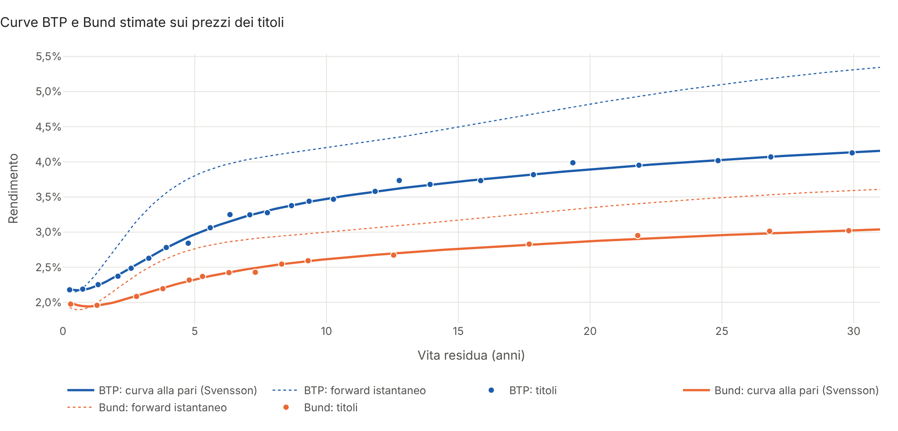
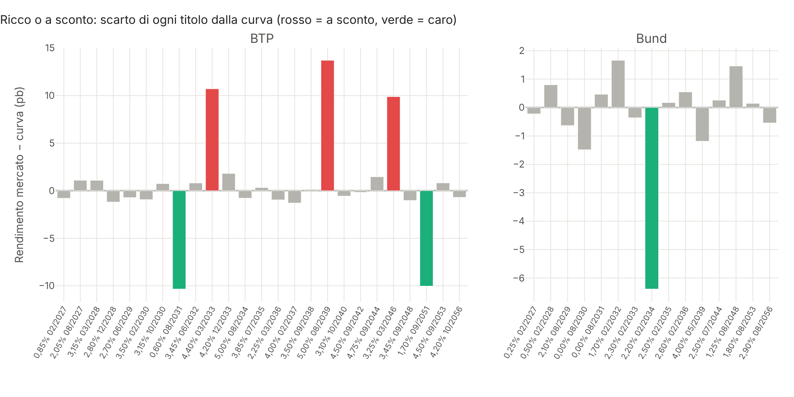
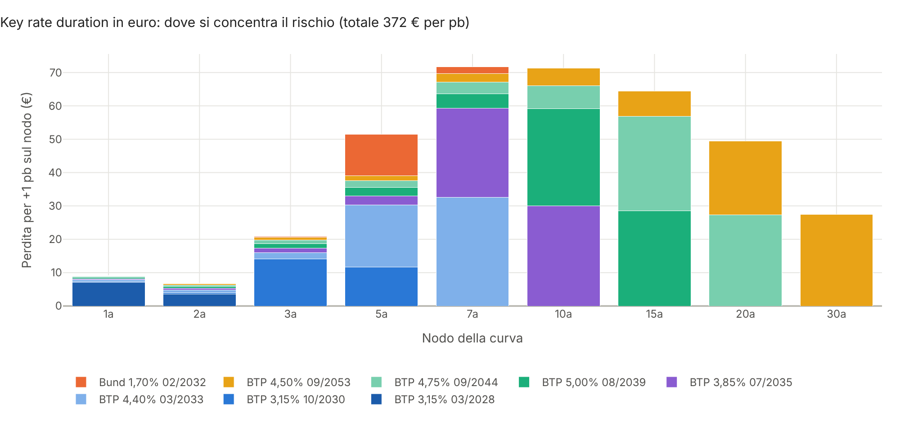
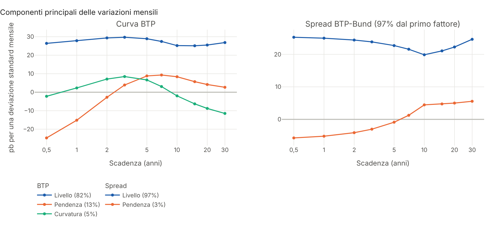
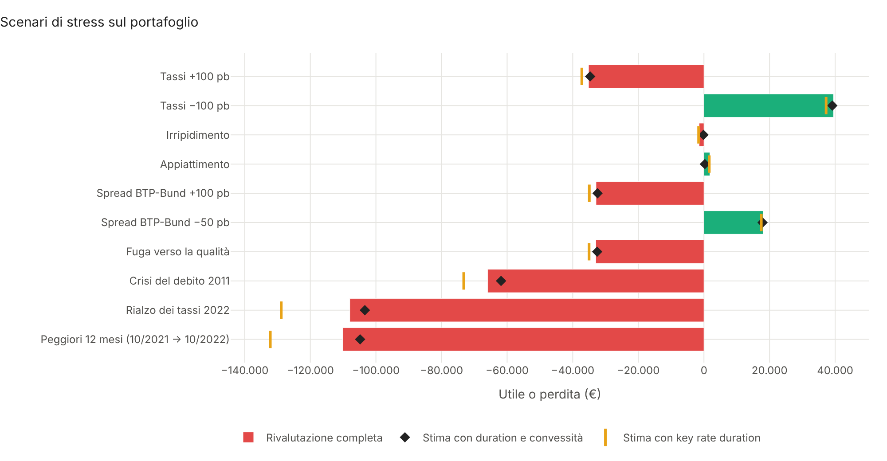
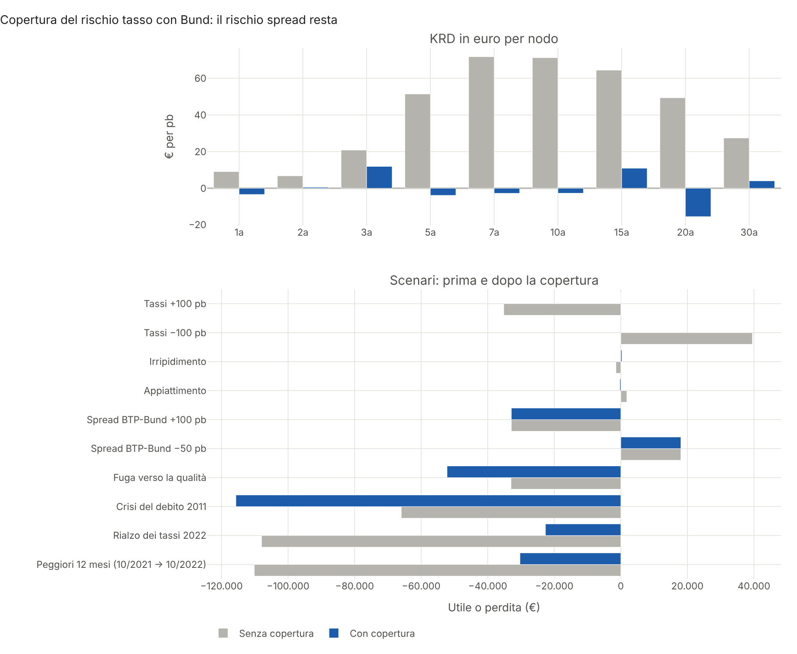
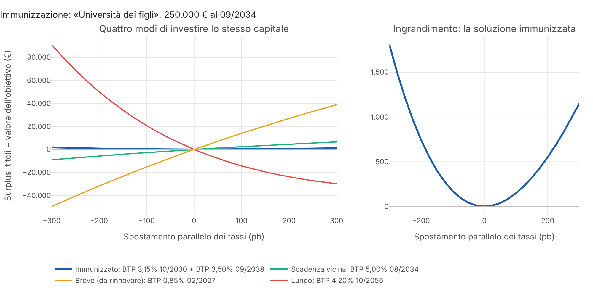

# Yield Curve Lab

**Curve dei tassi BTP e Bund e rischio di un portafoglio obbligazionario in Python: stima Nelson-Siegel e
Svensson sui prezzi dei titoli, analisi ricco/caro, key rate duration, componenti principali, scenari di spread,
VaR storico, copertura con Bund e immunizzazione di un obiettivo del cliente.**

Per un risparmiatore italiano i titoli di Stato sono spesso la parte più grande del patrimonio, e la duration è
l'unico numero di rischio che vede. Ma un portafoglio di BTP ha due rischi che si sommano proprio quando fa più
male: quello dei **tassi** e quello dello **spread** con la Germania. Il progetto risponde alle domande che un
consulente si pone davanti a un portafoglio obbligazionario: **quanto rende davvero ogni titolo rispetto alla
curva? Su quali scadenze è concentrato il rischio? Quanto si perderebbe in una crisi come quella del 2011 o in un
rialzo come quello del 2022? Coprirsi con i Bund serve? Come si mette al sicuro una spesa futura certa, come
l'università dei figli?** Il risultato è un **report HTML interattivo** pronto da discutere con il cliente.



## Cosa fa

| Area | Contenuto |
|---|---|
| **Titoli a cedola fissa** | Calendario delle cedole ricostruito dalla scadenza, **rateo ACT/ACT (ICMA)**, prezzo secco e tel quel da una curva, rendimento a scadenza, duration di Macaulay e modificata, convessità, DV01 |
| **Curve dei tassi** | Modelli di **Nelson-Siegel** e **Svensson** (quello di BCE e Bundesbank): tassi zero, fattori di sconto, forward istantanei, rendimenti alla pari |
| **Stima sui prezzi** | Minimi quadrati non lineari con vincoli sugli errori di prezzo pesati con l'inverso della duration, più punti iniziali; **stima robusta in due passi** che isola i titoli anomali |
| **Valore relativo** | Scarto di ogni titolo dalla curva in punti base: quali BTP sono **ricchi** e quali **a sconto** |
| **Rischio per scadenza** | **Key rate duration** con shock triangolari su nove nodi, in euro per posizione; duration e convessità effettive; **spread DV01** |
| **Fattori della curva** | **Analisi delle componenti principali** delle variazioni mensili: livello, pendenza e curvatura (Litterman-Scheinkman) per Bund, BTP e spread |
| **Scenari** | Rialzi e ribassi paralleli, irripidimento e appiattimento, **spread BTP-Bund ±**, fuga verso la qualità, **crisi del debito 2011**, **rialzo dei tassi 2022**, peggior periodo storico per il portafoglio; rivalutazione completa confrontata con le approssimazioni |
| **VaR storico** | Il portafoglio di oggi rivalutato con le variazioni delle curve di ogni mese dal 2008, a 1 e 12 mesi, VaR e CVaR |
| **Copertura** | Nominali di Bund che annullano le key rate duration ai minimi quadrati, con DV01 totale nullo |
| **Immunizzazione** | Obiettivo futuro coperto con due BTP (Redington): stesso valore, stessa duration, più convessità; confronto con le scelte «istintive» |
| **Report** | HTML in italiano con 9 grafici interattivi Plotly, tabelle per titolo e per scenario, sintesi in linguaggio semplice |

Tutto è scritto da zero su `numpy`, `scipy` e `pandas`, senza librerie di fixed income «a scatola chiusa», così
ogni passaggio è verificabile. Grafici `plotly`, report `jinja2`.

## Avvio rapido

```bash
git clone https://github.com/Torraf-MI/yield-curve-lab.git
cd yield-curve-lab
pip install -e ".[png]"

# Report con titoli, prezzi e portafoglio dimostrativi
yield-curve-lab --demo --cliente "Famiglia Rossi"

# Un cliente descritto in un file JSON, con i grafici anche in PNG
yield-curve-lab --config esempi/cliente.json --grafici output/img

# Report utilizzabile senza rete (plotly.js incluso nel file)
yield-curve-lab --demo --offline
```

Il report viene salvato in `output/report.html`. Un esempio già generato:
[`docs/report_esempio.html`](docs/report_esempio.html).

Il file JSON ([`esempi/cliente.json`](esempi/cliente.json)) indica i titoli con i prezzi (CSV con codice,
emittente, cedola, scadenza, frequenza e prezzo secco), facoltativamente la storia delle curve, il portafoglio,
i Bund da usare per la copertura e l'obiettivo da immunizzare:

```json
"portafoglio": [{"codice": "BTP-2032-06", "nominale": 100000}, {"codice": "BTP-2042-09", "nominale": 50000}],
"obiettivo": {"descrizione": "Acquisto della casa", "importo": 300000, "data": "2032-06-30"}
```

## Uso come libreria

```python
from yield_curve_lab import Portafoglio, Posizione, dati, key_rate_duration, stima_robusta
from yield_curve_lab.scenari import tassi_e_spread

v = dati.VALUTAZIONE
titoli, prezzi = dati.carica_titoli("data/titoli_esempio.csv")

btp = next(t for t in titoli if t.codice == "BTP-2035-07")
y = btp.rendimento(prezzi[btp.codice], v)          # rendimento a scadenza dal prezzo secco
print(btp.misure(y, v))                             # duration, convessità, DV01

stime = {em: stima_robusta([t for t in titoli if t.emittente == em], prezzi, v) for em in ("BTP", "Bund")}
s = stime["BTP"]
print(s.curva.zero(10.0), s.rmse_bp)                # tasso zero a 10 anni, errore in punti base
print(s.ricco_caro.sort_values())                   # titoli ricchi e a sconto
print(key_rate_duration(btp, s.curva, v))           # rischio per scadenza

port = Portafoglio([Posizione(btp, 100_000)], {em: x.curva for em, x in stime.items()}, v)
print(port.dv01(), port.krd())                      # euro per punto base, totale e per nodo
print(port.scenario(tassi_e_spread("Spread +100", "", [0] * 5, [100] * 5)))
```

Esempio completo in [`examples/esempio.py`](examples/esempio.py).

## Risultati sull'esempio dimostrativo

Il mercato è quello di fine ottobre 2026, simulato: 25 BTP e 15 Bund con scadenze fino al 2056, curva Bund dal
2,0% a 2 anni al 3,1% a 30, curva BTP dal 2,35% al 4,4%. Il cliente ha **€ 500.000 di nominale** distribuiti su
sette BTP dal 2028 al 2053 e un Bund, e deve pagare **€ 250.000 di università dei figli a settembre 2034**.

**Le curve.** Svensson riproduce i prezzi con un errore di **1,0 punti base** sui BTP e 0,9 sui Bund;
Nelson-Siegel, con una gobba sola, sbaglia di 5,3 e 2,8. La stima in due passi riconosce tutti e sei i titoli
volutamente fuori curva: tre BTP rendono 10-14 punti base più dei vicini, due ne rendono 10 di meno (vecchie
emissioni con cedola bassa), un Bund è caro di 6. Senza il secondo passo quei sei titoli deformano la curva e
l'errore medio sale a quasi 5 punti base.



**Dove sta il rischio.** Il portafoglio vale € 531.675, ha una duration di 6,9 e perde **€ 372 per punto base**.
Le key rate duration mostrano che il rischio è distribuito tra 5 e 20 anni, con il picco tra 7 e 10. Ma il 96%
di quella sensibilità è anche **rischio di spread**: se lo spread BTP-Bund si allarga di 100 punti base si perdono
€ 32.899 senza che i tassi tedeschi si muovano.



**I fattori della curva.** Le componenti principali delle variazioni mensili dal 2008 ritrovano livello, pendenza
e curvatura: sulla curva BTP spiegano l'82%, il 13% e il 5% della varianza. Lo spread si muove quasi in blocco
(97% dal primo fattore), per questo un portafoglio di BTP è esposto soprattutto al livello.



**Scenari e VaR.** Rivalutando il portafoglio titolo per titolo:

| Scenario | Utile/perdita | Con copertura in Bund |
|---|---|---|
| Tassi +100 pb | −35.182 € | 55 € |
| Tassi −100 pb | +39.527 € | −112 € |
| Spread BTP-Bund +100 pb | −32.899 € | −32.899 € |
| Fuga verso la qualità (Bund −50, spread +150) | −32.985 € | −52.209 € |
| Crisi del debito 2011 | −65.966 € | −115.664 € |
| Rialzo dei tassi 2022 | −107.953 € | −22.645 € |
| Peggiori 12 mesi (10/2021 → 10/2022) | −110.141 € | −30.299 € |

Il VaR storico al 99% a un mese è di **€ 25.251** (CVaR € 37.949). L'approssimazione con duration e convessità
regge per gli spostamenti paralleli ma sulle torsioni della curva sbaglia fino al 90%; le key rate duration
colgono la forma ma, essendo lineari, sopravvalutano di un quinto la perdita del 2022.



**La copertura con i Bund** (vendita di € 556.000 di nominale su sei scadenze) annulla il rischio tasso: il
rialzo del 2022 costerebbe un quinto. Ma non tocca lo spread, e nelle **fughe verso la qualità fa danni**: i Bund
salgono mentre i BTP scendono, e chi è corto di Bund perde due volte. Nella crisi del 2011 la perdita con la
copertura quasi raddoppia. Per questo il VaR mensile scende appena (da € 25.251 a € 24.940): coprire i tassi di un
portafoglio di BTP non lo rende sicuro.



**L'immunizzazione.** I € 250.000 del 2034 valgono oggi € 192.487 con una duration di 7,8 anni. Due BTP, il
3,15% 10/2030 e il 3,50% 09/2038, hanno lo stesso valore, la stessa duration e una convessità maggiore (78 contro
62): con qualunque spostamento parallelo fino a ±300 punti base il cliente ha un piccolo surplus. Le scelte
istintive con lo stesso capitale vanno sotto: il BTP che scade vicino all'obiettivo perde € 8.984 se i tassi
scendono (le cedole si reinvestono a meno), un BTP breve da rinnovare € 49.575, un trentennale € 29.796 se i
tassi salgono. L'immunizzazione resta però esposta alle torsioni: un irripidimento di 100 punti base tra 2 e 30
anni costa € 1.168.



## Metodologia in breve

- **Titoli**: date delle cedole ricostruite all'indietro dalla scadenza, rateo ACT/ACT (ICMA), tempi dei flussi
  ACT/365, rendimento a scadenza composto con la frequenza delle cedole (semestrale BTP, annuale Bund).
- **Curve**: z(t) = β₀ + β₁·(1 − e^(−t/τ₁))/(t/τ₁) + β₂·[(1 − e^(−t/τ₁))/(t/τ₁) − e^(−t/τ₁)] + β₃·[…τ₂…]
  (Nelson e Siegel, 1987; Svensson, 1994), tassi a capitalizzazione continua.
- **Stima**: minimizza Σ wᵢ²(Pᵢ<sup>modello</sup> − Pᵢ<sup>mercato</sup>)² con wᵢ = 1/Dᵢ, che equivale
  approssimativamente a minimizzare gli errori di rendimento (Bliss, 1997); trust region con vincoli da sei punti
  iniziali sui τ. Nel secondo passo i titoli oltre 3 deviazioni robuste (MAD) pesano il 5%.
- **Key rate duration**: shock triangolari di 1 pb sui nodi 1, 2, 3, 5, 7, 10, 15, 20, 30 anni (Ho, 1992),
  piatti prima del primo nodo e dopo l'ultimo, così la loro somma è uno spostamento parallelo e le KRD sommano al
  DV01.
- **PCA**: autovettori della covarianza delle variazioni mensili dei tassi zero su dieci nodi, segni normalizzati.
- **Scenari e VaR**: shock definiti sui nodi e interpolati linearmente; per i periodi storici le variazioni di
  ogni nodo di entrambe le curve sono riapplicate a quelle di oggi; rivalutazione completa di ogni titolo.
- **Copertura**: minimi quadrati sulle KRD in euro, con una riga in più che impone il DV01 totale nullo.
- **Immunizzazione**: due titoli con valore e duration effettiva uguali a quelli dell'obiettivo (Redington, 1952),
  scelti uno circa quattro anni prima e uno circa quattro anni dopo la scadenza dell'obiettivo.

## Struttura

```
src/yield_curve_lab/
├── curve.py           # Nelson-Siegel e Svensson, curve spostate, shock paralleli, triangolari e interpolati
├── obbligazioni.py    # cedole, rateo, prezzo, rendimento, duration, convessità, key rate duration
├── stima.py           # stima delle curve sui prezzi, stima robusta, ricco/caro
├── dati.py            # universo dimostrativo BTP e Bund, storia mensile delle curve dal 2008, CSV
├── pca.py             # componenti principali delle variazioni della curva
├── scenari.py         # scenari ipotetici e storici
├── portafoglio.py     # valore, sensibilità, KRD in euro, scenari, VaR storico
├── copertura.py       # copertura con Bund, immunizzazione di un obiettivo
├── analisi.py         # analisi completa
├── configurazione.py  # esempio dimostrativo e lettura da JSON
├── report.py          # grafici Plotly e report HTML
├── cli.py             # riga di comando
└── templates/         # modello del report
data/                  # titoli e prezzi, storia delle curve (CSV)
esempi/                # configurazione di un cliente in JSON
examples/              # uso come libreria
tests/                 # 31 test (pytest), eseguiti a ogni push con GitHub Actions
```

## Test

```bash
pip install -e ".[dev]"
pytest
```

I test verificano le proprietà dei metodi. Una curva piatta dà tassi costanti e un rendimento alla pari pari a
e<sup>r</sup> − 1; i forward coincidono con la derivata di t·z(t); un titolo con cedola pari al rendimento alla pari
vale 100. Rateo e calendario delle cedole sono controllati su un BTP reale per struttura; prezzo e rendimento si
invertono, duration e convessità approssimano il prezzo a meno del termine di terzo ordine e la duration di uno
zero coupon è la sua vita residua. Gli shock triangolari sommano a uno parallelo e le key rate duration sommano
alla duration effettiva. Su prezzi esatti la stima ritrova la curva vera entro 0,2 punti base e Svensson batte
Nelson-Siegel; la stima robusta trova esattamente i titoli anomali e ne misura lo scarto. I fattori della PCA sono
incorrelati e ordinati. Nel portafoglio le KRD sommano al DV01, uno scenario di solo spread non tocca i Bund, il
VaR è inferiore al CVaR, la copertura azzera il rischio tasso ma non quello di spread, e l'immunizzazione
pareggia valore e duration con surplus positivo per ogni spostamento parallelo. Infine configurazione JSON,
caricamento dei CSV e riga di comando funzionano dall'inizio alla fine.

## Avvertenze

I dati dell'esempio sono **simulati**: le curve, i prezzi e la storia ricalcano per livelli, date e ordine di
grandezza il mercato dei titoli di Stato italiani e tedeschi, ma i codici non sono ISIN e i numeri non sono quelli
di alcun titolo reale. Il modello non considera imposte, costi di transazione, liquidità, rischio di credito oltre
a quello di spread né le opzioni di consegna dei future. Il progetto ha scopo dimostrativo e non costituisce
consulenza finanziaria.

## Licenza

MIT. Autore: Francesco Torraco.
